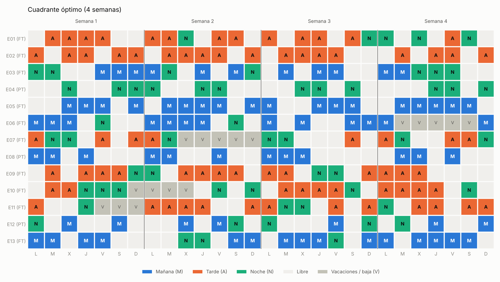
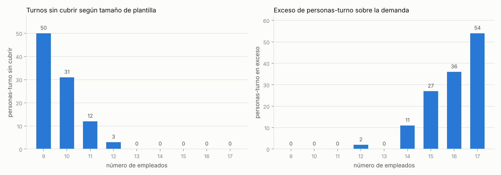
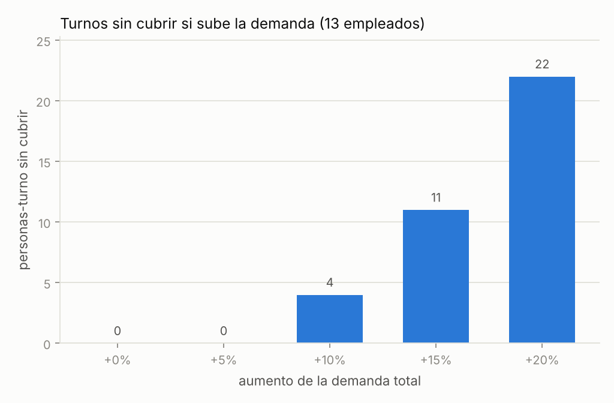

# Planificación de turnos con programación lineal entera

Modelo MILP que construye el cuadrante de 4 semanas de una plantilla con tres turnos (mañana, tarde, noche), cubriendo la demanda y respetando descansos, topes de jornada, vacaciones y mínimos de contrato, mientras minimiza las molestias por preferencias y reparte los fines de semana de forma equitativa. Incluye un **validador independiente**, **análisis de sensibilidad** (demanda, tamaño de plantilla y coste de cada regla) y una comparación de dos formulaciones de las restricciones de descanso.

Hecho con Python, [PuLP](https://coin-or.github.io/pulp/) y el solver [HiGHS](https://highs.dev/).



## Resultado en una línea

Con 13 empleados (10 jornada completa, 3 parcial) y 208 personas-turno de demanda, el óptimo se obtiene en ~1 s, cubre toda la demanda y la relajación lineal coincide con el óptimo entero (cota 132 = óptimo 132).

## Estructura del repositorio

```
├── src/rostering/
│   ├── instance.py    # datos: empleados, demanda, vacaciones, preferencias; generador reproducible
│   ├── model.py       # modelo MILP (PuLP + HiGHS) y función solve()
│   ├── validate.py    # validador independiente (sin PuLP) que recalcula reglas y objetivo
│   ├── analysis.py    # escenarios de sensibilidad y comparación de formulaciones
│   └── plots.py       # figuras
├── scripts/run_all.py # reproduce todos los resultados
├── tests/             # 29 tests (pytest)
├── data/instance_base.json
└── results/           # CSV, JSON y PNG generados por run_all.py
```

## Cómo ejecutarlo

```bash
pip install -r requirements.txt
python scripts/run_all.py   # ~1 min: resuelve todos los escenarios y escribe results/
pytest                      # ~3 s
```

> `requirements.txt` fija `pulp<4`: la serie 4.x cambió la API de creación de variables.
> La instancia es sintética y determinista (semilla fija). El solver usa 1 hilo y semilla 0 para que los resultados sean reproducibles; los tiempos son orientativos.

## El problema

- **Horizonte:** 28 días (empiezan en lunes). **Turnos:** Mañana 06-14, Tarde 14-22, Noche 22-06.
- **Demanda:** L-V 3 mañana / 3 tarde / 2 noche; S-D 2 / 2 / 2 (208 personas-turno).
- **Plantilla:** 13 empleados; uno de cada cuatro es de jornada parcial. Cada uno tiene un turno preferido (penalización 0), los demás cuestan 1 y la noche 3 (6 para quien la lleva mal). Algunos tienen un bloque de vacaciones (bloqueado) y 2-3 días en los que prefieren librar (penalización 4 si se les asigna).

## Formulación matemática

**Conjuntos.** $E$ empleados, $D=\{0,\dots,27\}$ días, $S=\{M,A,N\}$ turnos, $W$ semanas naturales, $D_{fs}\subset D$ días de fin de semana, $F\subseteq E$ empleados de jornada completa (grupo sobre el que se mide la equidad).

**Parámetros.** $r_{ds}$ demanda; $p_{eds}$ penalización de preferencia; $m_e$ mínimo de turnos del contrato; $c_e$ tope semanal; $U$ pares (empleado, día) bloqueados; $K=5$ días seguidos máximos; $K_N=3$ noches seguidas máximas; $\lambda_u=100$, $\lambda_f=2$.

**Variables.** $x_{eds}\in\{0,1\}$ (el empleado $e$ trabaja el turno $s$ el día $d$); $u_{ds}\in\mathbb{Z}_{\ge0}$ (personas que faltan); $w^{\max}, w^{\min}\ge 0$.

$$\min \sum_{e,d,s} p_{eds}\,x_{eds} \;+\; \lambda_f\,(w^{\max}-w^{\min}) \;+\; \lambda_u \sum_{d,s} u_{ds}$$

sujeto a

$$\sum_{s} x_{eds} \le 1 \qquad \forall e,d \tag{1 turno al día}$$

$$\sum_{e} x_{eds} + u_{ds} \ge r_{ds} \qquad \forall d,s \tag{cobertura}$$

$$\sum_{d'=d}^{d+K}\sum_{s} x_{ed's} \le K \qquad \forall e,\; d \le |D|-K-1 \tag{máx. días seguidos}$$

$$\sum_{d'=d}^{d+K_N} x_{ed'N} \le K_N \qquad \forall e,\; d \le |D|-K_N-1 \tag{máx. noches seguidas}$$

$$\sum_{d\in w}\sum_{s} x_{eds} \le c_e \qquad \forall e,\; w\in W \tag{tope semanal}$$

$$\sum_{d,s} x_{eds} \ge m_e \qquad \forall e \tag{mínimo del contrato}$$

$$\sum_{s} x_{eds} = 0 \qquad \forall (e,d)\in U \tag{vacaciones}$$

$$w^{\min} \le \sum_{d\in D_{fs}}\sum_{s} x_{eds} \le w^{\max} \qquad \forall e\in F \tag{equidad}$$

**Descanso mínimo de 11 h.** Están prohibidas las sucesiones Tarde→Mañana (8 h de descanso), Noche→Mañana (0 h) y Noche→Tarde (8 h). Se implementan de dos formas equivalentes:

- *pairwise:* una restricción por sucesión prohibida, p. ej. $x_{e,d,A}+x_{e,d+1,M}\le 1$.
- *clique:* como $x_{e,d,A}+x_{e,d,N}\le 1$ ya se cumple por (1 turno al día), los conjuntos $\{A_d,N_d,M_{d+1}\}$ y $\{N_d,M_{d+1},A_{d+1}\}$ son cliques del grafo de conflictos, y bastan dos desigualdades por empleado y día:

$$x_{e,d,A}+x_{e,d,N}+x_{e,d+1,M}\le 1, \qquad x_{e,d,N}+x_{e,d+1,M}+x_{e,d+1,A}\le 1$$

La formulación clique es al menos tan fuerte como la pairwise (su región lineal está contenida en la otra) y usa menos restricciones.

## Resultados

Todas las cifras salen de `scripts/run_all.py` (CSV en `results/`).

### Modelo base

| Métrica | Valor |
|---|---|
| Variables binarias / restricciones | 1 092 / 1 876 |
| Cota de la relajación lineal | 132 |
| Óptimo entero (gap 0 %) | 132 |
| Tiempo de resolución | ~1,2 s |
| Personas-turno sin cubrir | 0 |
| Fines de semana trabajados por los de jornada completa | 4 cada uno (diferencia máx-mín = 0) |

El cuadrante pasa por el validador independiente: cero violaciones y el objetivo recalculado coincide con el del solver.

### Sensibilidad al tamaño de la plantilla

La plantilla de $n$ personas son los $n$ primeros de un mismo conjunto, así que cada escenario añade o quita gente a la misma instancia.



- Con **12 empleados** faltan 3 personas-turno; con 11, 12; con 9, 50.
- **13 es el mínimo** que cubre toda la demanda en esta instancia.
- **Más de 13 no mejora el objetivo** (sigue en 132), pero los mínimos de contrato obligan a asignar turnos de sobra: 11, 27, 36 y 54 personas-turno en exceso con 14, 15, 16 y 17 empleados.

### Sensibilidad a la demanda (13 empleados)



| Aumento de demanda | Personas-turno sin cubrir | Coste de preferencias |
|---|---|---|
| +0 % | 0 | 132 |
| +5 % | 0 | 144 |
| +10 % | 4 | 156 |
| +15 % | 11 | 144 |
| +20 % | 22 | 123 |

La plantilla absorbe un 5 % más de demanda a costa de más molestias (132 → 144); a partir del 10 % ya no llega. (Cuando hay turnos sin cubrir, el coste de preferencias deja de ser comparable: el modelo prefiere dejar huecos antes que asignar muchos turnos poco deseados.)

### ¿Qué regla cuesta más?

Se resuelve el modelo ignorando una familia de restricciones cada vez y se mide cuánto baja el objetivo.

| Regla ignorada | Ahorro con demanda base | Ahorro con demanda +5 % |
|---|---|---|
| **Tope semanal de turnos** | **24** | **24** |
| Descanso entre turnos | 0 | 0 |
| Máx. 5 días seguidos | 0 | 0 |
| Máx. 3 noches seguidas | 0 | 0 |
| Mínimo del contrato | 0 | 0 |
| Vacaciones / bajas | 0 | 0 |

- Solo el **tope semanal** limita de verdad en esta instancia: sin él, el modelo puede concentrar más turnos baratos (de baja penalización) en las mismas personas.
- Un 0 significa que esa regla **no es la que limita el óptimo en esta instancia**, no que sobre: seguramente aparecería en instancias más ajustadas.
- La **equidad** sale gratis en preferencias: sin ella (peso 0) el coste de preferencias es el mismo (132), pero la diferencia entre quien más y quien menos fines de semana trabaja subiría de 0 a 4.

### Dos formulaciones del descanso: pairwise vs clique

Se comparó sobre 9 instancias (3 semillas × demanda +0/+5/+10 %), cada una con las dos formulaciones.

- Ambas dan **el mismo óptimo y la misma cota LP** en todas.
- La formulación clique tiene **~16 % menos restricciones** (1 876 frente a 2 227 en la instancia base).
- En **tiempo**, clique fue más rápida en 6 de las 9 instancias, con diferencias de décimas de segundo a ~1 s y todas resueltas en un solo nodo; con tan pocas ejecuciones no lo daría por concluyente.

Es decir, en instancias de este tamaño el solver ya cierra la relajación sin ayuda: la formulación más fuerte es teóricamente mejor, pero aquí no se nota. Compararía de nuevo con plantillas más grandes.

## Limitaciones

- **Datos sintéticos** y una sola instancia principal: los resultados de sensibilidad son de ese caso, no leyes generales.
- El objetivo **no incluye costes salariales ni penaliza el exceso de cobertura**, por eso añadir plantilla "no cuesta nada" en el modelo; en la realidad sí.
- La equidad se mide solo en fines de semana y solo entre jornada completa.
- La demanda es determinista; no hay incertidumbre en bajas o picos.
- El "coste de una regla" es una medida por relajación, no un precio sombra (el modelo es entero).

## Posibles ampliaciones

- Probar con instancias reales de *nurse rostering* (p. ej. las de Curtois y Qu, Univ. de Nottingham) y comparar con OR-Tools CP-SAT.
- Penalizar el exceso de cobertura y añadir coste por persona.
- Equidad en noches y en turnos poco deseados; peticiones de turno (no solo de día libre).
- Escenarios con bajas aleatorias (optimización robusta o estocástica).
- Heurística (búsqueda local) para instancias donde el MILP no cierre.
